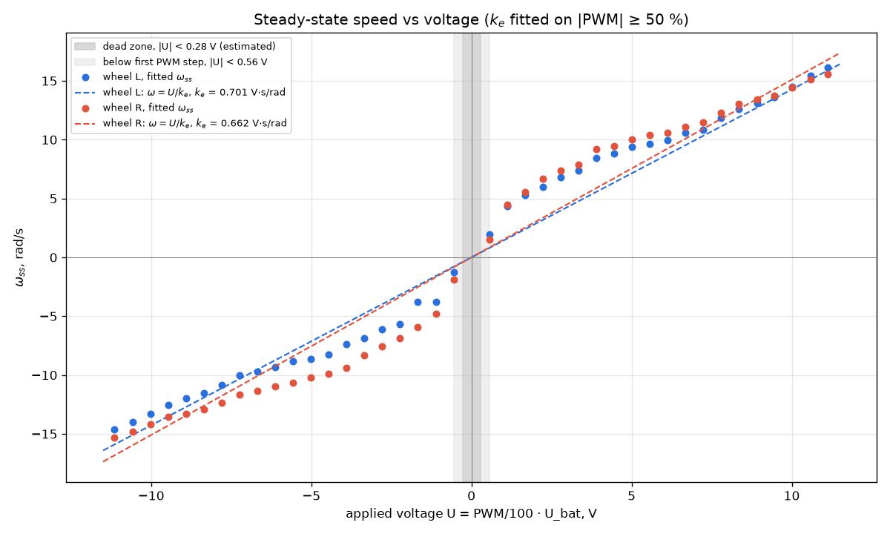
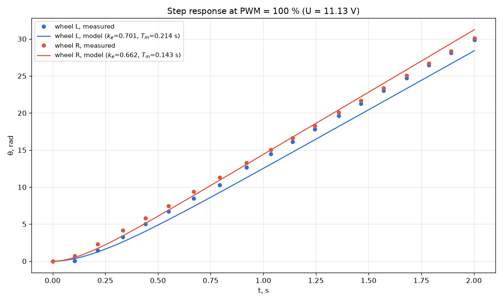

# Week 5 – DC motor parameter identification

## Experiment

`Data_collection.qrs` drives both motors (M3, M4) with the same PWM, sweeping from −100 % to +100 % in 5 % steps. Each step lasts ~2 s and is sampled every ~110 ms. Every sample line in `trik_data_bat.txt` is

`PWM %   left encoder (E4), deg   right encoder (E3), deg   t, ms   battery, V`

The battery stayed between 11.03 and 11.18 V, so the voltage actually applied to the motor is $U = \frac{PWM}{100}\,U_{bat}$.

## Method

For every PWM level and each wheel, the first-order motor model

$$\theta(t) = \omega_{ss}\left(t - T_m + T_m e^{-t/T_m}\right), \qquad \omega_{ss} = \frac{U}{k_e}$$

was fitted to the measured angle with `scipy.optimize.curve_fit`. This gives $\omega_{ss}$ and $T_m$. Each wheel's $k_e$ comes from a least-squares line $\omega_{ss} = U/k_e$ through the origin, using only the runs with $|PWM| \geq 50\,\%$. Code: `identification.ipynb` (step-by-step analysis) and `make_report_figures.py` (makes every figure and table in this report).

## Results

| | $k_e$, V·s/rad (both directions) | $k_e$ forward / reverse | median $T_m$ at \|PWM\| ≥ 50 % | dead zone |
|---|---:|---:|---:|---:|
| Left wheel (E4) | 0.701 | 0.671 / 0.734 | 0.214 s | ≈ 0.27 V |
| Right wheel (E3) | 0.662 | 0.661 / 0.664 | 0.143 s | ≈ 0.28 V |

The dead zone was estimated by extending a line through the two lowest PWM levels at which the wheel moved, on each side, down to ω = 0. The sweep only proves it is narrower than one PWM step: at 0 % neither wheel moved, and at ±5 % (0.56 V) both did.

### $T_m$ and $\omega_{ss}$ for every PWM level

| PWM, % | U, V | L: ω_ss, rad/s | L: T_m, s | R: ω_ss, rad/s | R: T_m, s |
|---:|---:|---:|---:|---:|---:|
| -100 | -11.14 | -14.59 | 0.200 | -15.29 | 0.141 |
| -95 | -10.58 | -13.96 | 0.143 | -14.83 | 0.090 |
| -90 | -10.02 | -13.27 | 0.176 | -14.18 | 0.122 |
| -85 | -9.47 | -12.54 | 0.214 | -13.55 | 0.130 |
| -80 | -8.91 | -11.96 | 0.200 | -13.33 | 0.151 |
| -75 | -8.36 | -11.52 | 0.213 | -12.93 | 0.138 |
| -70 | -7.80 | -10.83 | 0.228 | -12.38 | 0.206 |
| -65 | -7.24 | -10.01 | 0.248 | -11.66 | 0.242 |
| -60 | -6.69 | -9.71 | 0.232 | -11.37 | 0.229 |
| -55 | -6.13 | -9.30 | 0.294 | -10.96 | 0.278 |
| -50 | -5.57 | -8.85 | 0.290 | -10.63 | 0.292 |
| -45 | -5.02 | -8.62 | 0.308 | -10.21 | 0.280 |
| -40 | -4.46 | -8.26 | 0.330 | -9.90 | 0.306 |
| -35 | -3.90 | -7.39 | 0.146 | -9.36 | 0.314 |
| -30 | -3.34 | -6.85 | 0.374 | -8.34 | 0.359 |
| -25 | -2.79 | -6.12 | 0.358 | -7.58 | 0.378 |
| -20 | -2.23 | -5.68 | 0.485 | -6.85 | 0.385 |
| -15 | -1.67 | -3.80 | 0.268 | -5.90 | 0.429 |
| -10 | -1.11 | -3.77 | 0.430 | -4.77 | 0.393 |
| -5 | -0.56 | -1.28 | 0.277 | -1.91 | 0.398 |
| 0 | 0.00 | – | – | – | – |
| 5 | 0.56 | 1.94 | 0.543 | 1.50 | 0.462 |
| 10 | 1.11 | 4.35 | 0.523 | 4.50 | 0.474 |
| 15 | 1.67 | 5.27 | 0.443 | 5.57 | 0.416 |
| 20 | 2.23 | 5.98 | 0.395 | 6.68 | 0.413 |
| 25 | 2.78 | 6.78 | 0.403 | 7.40 | 0.407 |
| 30 | 3.34 | 7.35 | 0.373 | 7.87 | 0.114 |
| 35 | 3.90 | 8.46 | 0.333 | 9.18 | 0.315 |
| 40 | 4.46 | 8.82 | 0.317 | 9.42 | 0.142 |
| 45 | 5.01 | 9.39 | 0.307 | 10.03 | 0.270 |
| 50 | 5.57 | 9.61 | 0.300 | 10.41 | 0.273 |
| 55 | 6.13 | 9.97 | 0.295 | 10.58 | 0.147 |
| 60 | 6.68 | 10.57 | 0.268 | 11.10 | 0.143 |
| 65 | 7.24 | 10.86 | 0.266 | 11.50 | 0.224 |
| 70 | 7.80 | 11.87 | 0.240 | 12.29 | 0.142 |
| 75 | 8.35 | 12.61 | 0.191 | 13.04 | 0.162 |
| 80 | 8.91 | 13.12 | 0.176 | 13.40 | 0.138 |
| 85 | 9.46 | 13.59 | 0.187 | 13.76 | 0.122 |
| 90 | 10.01 | 14.47 | 0.188 | 14.43 | 0.132 |
| 95 | 10.58 | 15.42 | 0.147 | 15.14 | 0.087 |
| 100 | 11.13 | 16.11 | 0.142 | 15.55 | 0.068 |

At 0 % neither wheel moved, so there is nothing to fit.

### Steady-state speed vs voltage

### Step response, measured vs simulated

The model is integrated with `odeint`, using each wheel's identified $k_e$ and $T_m$ from the table above (not the values fitted to this particular run). At t = 2 s the simulated angle is 1.5 rad (5 %) low for the left wheel and 1.2 rad (4 %) high for the right wheel.

## Discussion

The linear model $\omega = U/k_e$ only holds above about |PWM| = 50 %: below that, the measured speed is 30–63 % higher than the line predicts (≈4 rad/s already at 10 % PWM), and below ≈0.28 V the wheel does not turn at all. $T_m$ is not constant either: it rises from ≈0.1–0.2 s at full power to ≈0.4–0.5 s near the dead zone, so one first-order model is only valid near the operating point it was identified at. The two wheels differ by only 3–5 % at ±100 %, but by 8 % at +50 % and 18 % at −50 %, and which wheel is faster depends on PWM and direction. The left wheel is also asymmetric on its own ($k_e$ 0.671 forward vs 0.734 reverse), which is why one $k_e$ per wheel leaves the step-response model 5 % off. The encoders record what the wheels really did, so next week's odometry will log the mismatch as a real heading change; but at the go-to-goal base power of 50 %, equal commands make the right wheel 8 % faster, which turns the robot left at ≈9 °/s (≈90° in 10 s) unless the heading controller corrects it. Because the mismatch changes with PWM and direction, one constant trim factor cannot fix it, and any position prediction made from PWM instead of encoders will drift by the same amount.

## Notes and limitations

- **Left/right labels.** `Data_collection.qrs` logs E4 as the left wheel (`theta_l = encoder4`), but the Week 4 odometry code reads E3 as the left wheel (`oldL = brick.encoder("E3")`). Check which one is physically on the left: if they are swapped, the odometry heading has the wrong sign. The "turns left" above assumes E4 is the left wheel.
- **Sampling is coarse.** With one sample every ~110 ms and $T_m$ ≈ 0.1–0.2 s, only one or two samples fall inside the acceleration phase, so single-run values of $T_m$ scatter widely (0.07–0.29 s at high PWM). $T_m$ and $\omega_{ss}$ also trade off against each other inside one fit. Logging at 5–10 ms, as last year's `collect_data.py` did, would pin $T_m$ down much better.
- **Delay before the wheel starts.** At the start of each run the wheel has barely moved by the first ~0.1 s. The first-order model has no term for this delay, so it ends up inside $T_m$.
